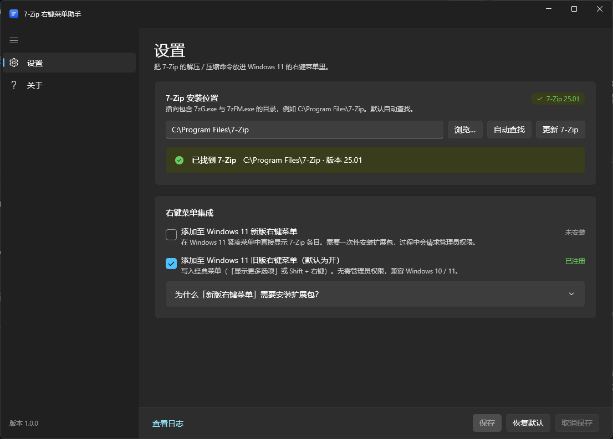
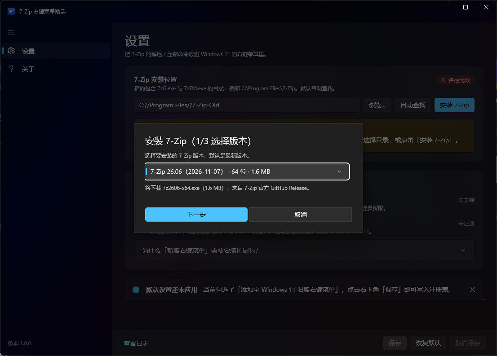

# 7-Zip 右键菜单助手（7zAIWin11RCM）

[](https://github.com/Minecraftmc22/7zAIWin11RCM/actions/workflows/build.yml)

把 7-Zip 的解压 / 压缩命令重新放回 **Windows 11 的右键菜单** —— 既支持新版（紧凑）菜单，也支持旧版（经典）菜单，一个开关搞定。



> 界面基于 WinUI 3（Windows App SDK）+ Mica 材质，自动跟随系统浅色 / 深色主题。

---

## 功能

| 功能 | 说明 |
| --- | --- |
| 自动查找 7-Zip | 依次查注册表（`HKLM\SOFTWARE\7-Zip` 的 `Path64` / `Path`）、Program Files、PATH、便携版目录 |
| 一键安装 7-Zip | 没装 7-Zip 时出现「安装 7-Zip」按钮：选版本（默认最新）→ 带进度下载 → 选目录 → 静默安装 |
| 检查更新 | 已装 7-Zip 时出现「更新 7-Zip」按钮：自动比对在线最新版，有新版本就带进度下载并覆盖升级 |
| 手动指定 | 「浏览…」选择安装目录；也接受直接填入 `7zG.exe` 的路径 |
| 新版右键菜单 | 在 Windows 11 紧凑菜单里直接出现 7-Zip 条目（稀疏 MSIX + COM 扩展） |
| 旧版右键菜单 | 写入经典菜单（`显示更多选项` 或 `Shift + 右键`），**默认开启** |
| 保存 / 恢复默认 / 取消保存 | 「取消保存」= 放弃未保存的改动，界面回滚到上次保存的状态 |
| 状态回显 | 实时显示 7-Zip 版本、两项菜单的注册状态、未保存改动提示 |
| 关于页 | 作者、GitHub、博客、仓库地址（可一键复制 / 打开） |
| 自愈 | 程序被移动到别处后，启动时自动重写注册表里失效的命令行 |

## 系统要求

- **Windows 10 1809+ / Windows 11**
  - 新版右键菜单需要 Windows 11（内部版本 22000+）
- **7-Zip**：任意包含 `7zG.exe` 与 `7zFM.exe` 的版本（21.x 及以上均可）
- **运行时**：.NET 8 运行时（x64）
- **构建**：.NET 8 SDK；Windows App SDK 已随应用自包含，目标机无需另行安装

## 快速开始

```powershell
git clone https://github.com/Minecraftmc22/7zAIWin11RCM.git
cd 7zAIWin11RCM
.\build.ps1            # 默认 Release / win-x64
# 或： .\build.ps1 -Configuration Debug -Run
```

也可以用 Visual Studio 2022 直接打开 `7zAIWin11RCM.sln`。

构建产物：

```
src\7zAIWin11RCM\bin\Release\net8.0-windows10.0.19041.0\win-x64\SevenZipAIWin11RCM.exe
```

该目录是自包含的（含 `shell\`、`scripts\`、`packaging\`），整体复制即可运行。

### 使用步骤

1. 打开程序，确认「7-Zip 安装位置」已被自动识别（绿色徽标显示版本号）；
2. 勾选需要的菜单项；
3. 点「保存」。

菜单项（目录 / 文件 / 驱动器 / 文件夹空白处）：

- 解压到当前文件夹
- 解压到新文件夹
- 添加到压缩包（生成 `名称.7z`）
- 用 7-Zip 打开

### 命令行开关旧版菜单

不想开界面时可以直接用命令行，适合写脚本或排错：

```powershell
# 写入（目录可省略，省略时自动查找 7-Zip）
SevenZipAIWin11RCM.exe --legacy-menu on
SevenZipAIWin11RCM.exe --legacy-menu on --seven-zip "D:\Apps\7-Zip"

# 移除
SevenZipAIWin11RCM.exe --legacy-menu off

# 诊断新版菜单的安装前提（只读，不弹 UAC）
SevenZipAIWin11RCM.exe --modern-menu diag
```

`--modern-menu diag` 会打印：系统版本、账户是否在管理员组、打包工具是否就位、脚本/清单/DLL 是否存在、脚本语法检查结果，以及一次「不提权试跑」的退出码与日志。装不上新版菜单时先跑它，问题基本能直接定位。

### 如果本机还没装 7-Zip

程序检测不到 7-Zip 时，路径输入框右侧会多出一个「安装 7-Zip」按钮，点它走三步向导：



1. **选择版本**：版本列表来自 7-Zip 官方 GitHub Release（`ip7z/7zip`），默认选中最新版，并显示架构与安装包大小；断网时回退到内置版本列表。
2. **下载**：实时显示进度、已下载 / 总大小与速度，可随时取消。
3. **选择安装位置**：默认 `C:\Program Files`，可直接浏览选择。程序会在所选目录后自动追加 `7-Zip` 子目录（若你直接选中了 `7-Zip` / `7zip` 目录则不再重复追加），因此默认安装路径就是 `C:\Program Files\7-Zip`。点「开始安装」后静默执行官方安装包（`/S /D=`，会请求管理员权限）。

安装完成后路径会自动填回设置页，点「保存」即可连同菜单选项一起生效。

### 检查并更新 7-Zip

检测到 7-Zip 后，同一个位置会换成「更新 7-Zip」按钮，点一下即自动完成版本比对：

- 读取本机 `7zFM.exe` 的版本号（例如 `25.01`），与在线最新版（例如 `26.06`）按「主.次」两段数值比较；
- 已是最新 → 弹窗告诉你当前版本与在线版本，什么都不用做；
- 有新版本 → 直接进入更新向导：自动下载对应架构的安装包（带进度），确认安装位置后点「开始更新」，静默覆盖升级到**原有安装目录**（目录只读、无法误改，7-Zip 原有设置与右键集成保持在原位）；
- 版本号读不出来时（极少见）会直接按最新版覆盖安装，不影响使用。

## 两种菜单有什么区别

| | 旧版（经典）菜单 | 新版（紧凑）菜单 |
| --- | --- | --- |
| 出现位置 | `显示更多选项` / `Shift + 右键` | 一级右键菜单 |
| 实现方式 | `HKCU\Software\Classes\...\shell` 注册表 verb | 稀疏 MSIX 包 + `IExplorerCommand` COM 扩展 |
| 需要管理员 | 否 | 是（安装证书 + 注册应用包） |
| 需要额外组件 | 无 | Windows SDK 的 `MakeAppx.exe` / `signtool.exe` |
| 生效时间 | 立即 | 需重启「Windows 资源管理器」 |
| 适用系统 | Windows 10 / 11 | Windows 11 22000+ |
| 标准用户账户 | 可用 | 不可用（见下） |

> Windows 11 的紧凑菜单**只接受带「应用包标识」的 `IExplorerCommand` 扩展**，普通注册表项无法进入该菜单 —— 这就是新版菜单需要单独安装扩展包的原因。

> ⚠️ **标准（非管理员）账户用不了新版菜单**：MSIX 扩展是按账户注册的。用管理员账户密码授权时，包会装到那个管理员账户上，当前账户依然看不到菜单。这种情况请只用旧版菜单 —— 它不需要任何权限，功能也完全够用。

### 旧版菜单的子菜单是怎么做的

父项用 `ExtendedSubCommandsKey` 指向 `HKCU\Software\Classes\7zAIWin11RCM.File`（文件夹是 `...Folder`）这个独立键，真正的动作放在该键的 `shell` 子键下。

实测（Windows 11 Build 26200）**空 `SubCommands` 和显式动词列表都只会渲染出一个空菜单**，只有 `ExtendedSubCommandsKey` 能正常列出子项；因此三种写法里选了后者。

文件夹空白处的右菜单更特殊：`Directory\Background` 作用域下三种级联写法全部失效，所以那里不做二级菜单，直接挂一条「7-Zip 添加到压缩包」。

## 新版菜单是怎么实现的

```
7zAIWin11RCM.exe            WinUI 3 主程序（设置界面 / 旧版菜单注册 / 调用安装脚本）
 └─ shell\
     SevenZipAIWin11RCM.ShellExt.comhost.dll   .NET COM 宿主，内含 3 个 IExplorerCommand 实现
     SevenZipAIWin11RCM.ShellExt.dll
 └─ packaging\
     AppxManifest.xml       稀疏包清单（uap10:AllowExternalContent + ComServer + FileExplorerContextMenus）
     Assets\*.png
 └─ scripts\
     install-modern-menu.ps1 / uninstall-modern-menu.ps1
```

勾选「新版右键菜单」并保存时，主程序以管理员权限调用 `install-modern-menu.ps1`：

1. 用 `MakeAppx.exe` 把 `AppxManifest.xml` 打成稀疏 MSIX；
2. 创建自签名证书（`CN=7zAIWin11RCM`）并加入「受信任人」存储，用 `signtool.exe` 签名；
3. `Add-AppxPackage -Path ... -ExternalLocation <应用目录>` 注册，外部内容指向应用自身目录；
4. 资源管理器随后即可通过包内声明的 CLSID 加载 COM 扩展，弹出菜单命令。

**排错**：点左下角「查看日志」，或查看
`%LOCALAPPDATA%\7zAIWin11RCM\app.log`；脚本的完整输出也会写在临时目录的 `setup-*.log` 里并在界面提示中回显。

如果系统没有 Windows SDK 打包工具，脚本会直接返回「系统缺少打包工具」，此时只使用旧版菜单即可，功能完全不受影响。

## 项目结构

```
.
├─ 7zAIWin11RCM.sln
├─ build.ps1                     一键构建（先扩展、后主程序，可传 -AppVersion）
├─ .github\workflows\build.yml   GitHub Actions：构建 + 打包 + tag 自动发版
├─ src
│  ├─ 7zAIWin11RCM               WinUI 3 主程序
│  │  ├─ Program.cs              自定义入口（右键菜单动词走无窗口快速路径）
│  │  ├─ MainWindow.xaml         导航外壳（Mica / 自定义标题栏）
│  │  ├─ Views\SettingsPage      设置页（路径 / 安装按钮 / 两个勾选框 / 底部操作栏）
│  │  ├─ Views\AboutPage         关于页（作者 / 仓库 / 运行环境）
│  │  ├─ Dialogs\InstallSevenZipDialog  安装 / 更新 7-Zip 向导
│  │  └─ Services
│  │     ├─ SevenZipLocator.cs   7-Zip 自动查找与校验
│  │     ├─ SevenZipReleaseCatalog.cs  从 GitHub Release 拉取版本列表
│  │     ├─ SevenZipInstaller.cs 下载安装包（带进度）与静默安装
│  │     ├─ SevenZipVersion.cs   版本号解析与比较（主.次两段）
│  │     ├─ LegacyMenuService.cs 旧版菜单注册表读写
│  │     ├─ ModernMenuService.cs 新版菜单扩展安装/卸载（调用 PowerShell）
│  │     ├─ ShellVerbHandler.cs  右键菜单实际执行的命令（解压 / 压缩 / 打开）
│  │     └─ SettingsStore.cs     %LOCALAPPDATA% 下的设置与日志
│  └─ SevenZipAIWin11RCM.ShellExt COM 宿主扩展（IExplorerCommand × 3）
├─ packaging                    稀疏 MSIX 清单与图标
├─ scripts                      新版菜单安装 / 卸载脚本
├─ tools\make_assets.py         生成图标与 Logo（纯 Python）
└─ docs                         截图
```

菜单命令并不直接拼注册表命令串，而是回调主程序：

```
"…\SevenZipAIWin11RCM.exe" --verb extract-here "%1"
```

路径计算、目标目录、压缩包命名都在 C# 里完成，避免注册表里 `%1` 拼接的坑；这类调用不会初始化 XAML，秒开秒退。

## 自动构建与发布（GitHub Actions）

`.github/workflows/build.yml` 会在 GitHub 托管的 Windows 运行器上构建、打包并按需发版：

| 触发条件 | 行为 |
| --- | --- |
| push 到 `main` / Pull Request | 构建 `win-x64`，上传 zip 构建产物（保留 14 天） |
| push 标签 `v*` | 同上，并自动创建 GitHub Release，附上 `7zAIWin11RCM-<版本>-win-x64.zip` |
| 手动 `workflow_dispatch` | 仅构建并上传产物 |

发版只需要打一个 tag：

```bash
git tag v1.2.0
git push origin v1.2.0
```

tag 去掉前缀 `v` 后就是版本号，会写入 exe 的文件版本、关于页显示的版本以及 Release 标题。本地等价命令：`.\build.ps1 -AppVersion 1.2.0`。

## 常见问题

**旧版菜单里 7-Zip 变成了空菜单 / 点开什么都没有？**
v1.0.0 的子菜单写法在新版 Windows 11 上不再生效（父项在、子项为空）。v1.0.1 起改用 `ExtendedSubCommandsKey`，更新程序后**取消勾选保存一次、再勾选保存一次**（或直接跑 `--legacy-menu off` 再 `--legacy-menu on`）即可清除旧写法。

**勾了新版菜单但菜单里没有？**
先确认当前是不是管理员账户。标准账户即使输入管理员密码授权，扩展也会装到那个管理员账户上，当前账户依旧看不到 —— 这种情况请用旧版菜单。

管理员账户则重启「Windows 资源管理器」（任务管理器 → 右键 → 重新启动），再确认包已安装：

```powershell
Get-AppxPackage -Name 7zAIWin11RCM.ShellExt
```

**提示安装失败 / 需要 Windows SDK？**
安装 [Windows SDK](https://developer.microsoft.com/windows/downloads/windows-sdk/)（含 MakeAppx 与 SignTool），或只使用旧版菜单。

**提示「打包或签名失败」？**
v1.0.4 起日志会带上 MakeAppx / signtool 的原始输出。常见两类：

- `No certificates were found that met all the given criteria` —— 证书建在 `LocalMachine\My`，signtool 必须带 `/sm` 才会去机器存储里找（旧版本漏了这个参数）。
- `SignerSign() failed` / `0x8007000B` —— 证书主题与清单 `Publisher` 不一致。两者都必须是 `CN=7zAIWin11RCM`，改成别的名字就会失败。

新版菜单的签名用本机自签名证书，程序会自动把它导入「受信任人」与「受信任的根证书颁发机构」两个存储。想手动查看证书状态：

```powershell
certutil -store My 7zAIWin11RCM
```

**不要用「以管理员身份运行」启动本程序**
菜单和扩展都是按账户注册的（旧版写 `HKCU`，新版是 MSIX）。以管理员身份运行时，注册会落到管理员账户上，你自己的日常账户反而看不到菜单。正确做法是普通双击启动，等保存时由程序自己弹出授权提示。

**「安装 7-Zip」下载失败或速度很慢？**
版本列表来自 GitHub，网络受限时可能拉取失败（会自动回退到内置版本列表）。也可以直接从 [7-zip.org](https://www.7-zip.org/download.html) 下载安装包自行安装，然后在设置页用「浏览…」指定目录即可，功能不受影响。

**安装向导为什么要管理员权限？**
7-Zip 默认安装到 `C:\Program Files\7-Zip` 并写 HKLM 注册表，官方安装包本身要求提权；向导只是调用官方安装包（`/S /D=`），不会额外做别的事。取消 UAC 会退回上一步，不会留下半装状态。

**如何彻底清理？**

```powershell
# 旧版菜单（父项）
Remove-Item -Recurse "HKCU:\Software\Classes\*\shell\7zAIWin11RCM"
Remove-Item -Recurse "HKCU:\Software\Classes\Directory\shell\7zAIWin11RCM"
Remove-Item -Recurse "HKCU:\Software\Classes\Directory\Background\shell\7zAIWin11RCM"
Remove-Item -Recurse "HKCU:\Software\Classes\Drive\shell\7zAIWin11RCM"
Remove-Item -Recurse "HKCU:\Software\Classes\Folder\shell\7zAIWin11RCM"

# 旧版菜单（子菜单动作）
Remove-Item -Recurse "HKCU:\Software\Classes\7zAIWin11RCM.File"
Remove-Item -Recurse "HKCU:\Software\Classes\7zAIWin11RCM.Folder"
Remove-Item -Recurse "HKCU:\Software\Classes\7zAIWin11RCM.Background"

# 新版菜单
Get-AppxPackage -Name 7zAIWin11RCM.ShellExt | Remove-AppxPackage

# 设置与日志
Remove-Item -Recurse "$env:LOCALAPPDATA\7zAIWin11RCM"
```

**程序目录被移动过，右键菜单点了没反应？**
重新打开程序并保存一次；程序启动时也会自动检测并修复失效的命令行。

## 作者

- 作者：**Minecraftmc22**
- GitHub：<https://github.com/Minecraftmc22>
- 博客：<https://minecraftmc22.top>
- 仓库：<https://github.com/Minecraftmc22/7zAIWin11RCM>

## 许可

[GNU AGPL-3.0](LICENSE) © 2026 Minecraftmc22

本项目与 7-Zip 官方无关，仅调用其 `7zG.exe` / `7zFM.exe` 命令行与图形界面组件。7-Zip 版权归 Igor Pavlov 所有。
